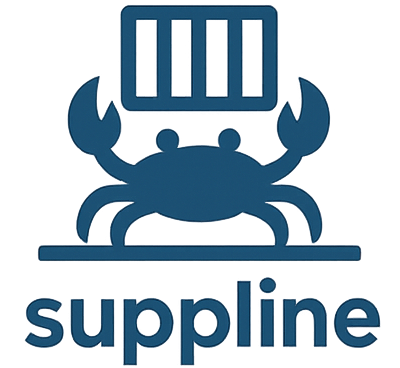
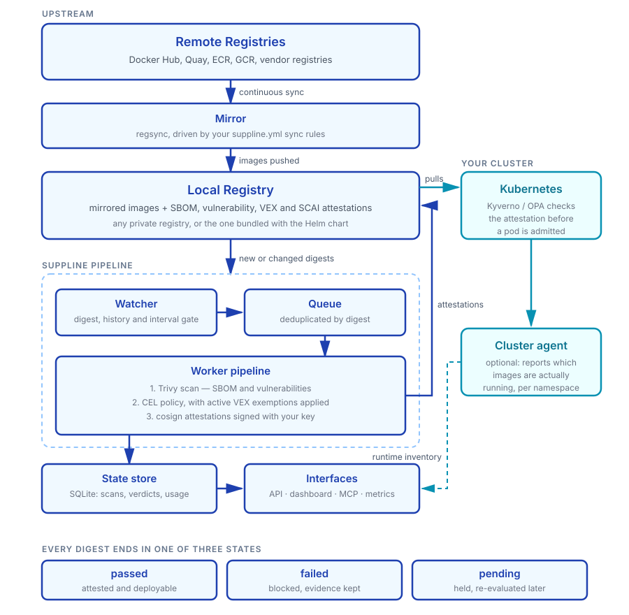

<p align="center">
  
</p>

<p align="center">
  <strong>Self-hosted image intake gateway for Kubernetes.</strong><br/>
  Mirror → Scan → Gate → Attest → Run.
</p>

<p align="center">
  <a href="LICENSE"></a>
  
  
  <a href="https://suppline.cloud"></a>
</p>

---

suppline copies the container images your cluster runs into a registry you control, scans every digest, and signs a verdict. The cluster then pulls from that registry, and can refuse to start anything without a fresh, valid attestation.

One Go binary, with state in PostgreSQL, running on your own infrastructure. **Used in production at [SocialHub](https://www.socialhub.io).**

## Try it

No credentials, no clone, no build. Compose 2.23.1 or newer:

```bash
curl -fsSLO https://github.com/daimoniac/suppline/releases/latest/download/docker-compose.eval.yml
docker compose -f docker-compose.eval.yml up -d
```

Open **http://localhost:8080** and log in with API key **`demo`**. The first boot pulls images and downloads Trivy's vulnerability database, so give it a few minutes.

You should then see one image **pass** (with signed attestations) and one **fail**. Prove that gate without a cluster:

```bash
docker compose -f docker-compose.eval.yml --profile eval-gate run --rm eval-gate
```

Checklist, ports, and what each demo image is for: **[docs/EVAL.md](docs/EVAL.md)**.

## Run it on a cluster

**[docs/FIRST_CLUSTER.md](docs/FIRST_CLUSTER.md)** installs suppline, builds the mirror list from the images the cluster already runs, and keeps admission in report-only mode until you choose to enforce.

With no `policy:` in the config, every image is judged by the built-in default: no critical vulnerabilities, and no high vulnerability that is known exploited. The UI states that in words. Tightening it, exemptions, and per-repository rules are in **[docs/POLICY.md](docs/POLICY.md)**.

A production install uses Helm and a registry you already run. The chart's [README](charts/suppline/README.md) has the install; [docs/REGISTRY.md](docs/REGISTRY.md) covers the registry.

## What it does

<p align="center">
  
</p>

1. **Mirror** the repositories you list into your registry.
2. **Scan** each new digest with Trivy.
3. **Gate** it with your policy. A failure on an image that is actually running can be triaged.
4. **Attest** the verdict with cosign, next to the image.
5. **Run** from the mirror. Kyverno verifies the attestation at admission, so the gate holds while suppline is down.

The exact lifecycle is in [docs/STATE_MACHINE.md](docs/STATE_MACHINE.md).

## Documentation

| | |
|---|---|
| [Eval](docs/EVAL.md) | The Compose try-out above, in full |
| [First cluster](docs/FIRST_CLUSTER.md) | From a running cluster to gated admission |
| [Policy](docs/POLICY.md) | The default policy, CEL, exemptions |
| [Configuration](docs/CONFIGURATION.md) | `suppline.yml`, secrets, scanning images you build yourself |
| [Registry](docs/REGISTRY.md) | Bring your own registry |
| [Observability](docs/OBSERVABILITY.md) | Health endpoints and metrics |
| [How it compares](docs/COMPARISON.md) | Next to Trivy Operator, Harbor, Kyverno |
| [Chart](charts/suppline/README.md) | Helm install |
| [Release](docs/RELEASE.md) | Images and the OCI chart |
| [Contributing](AGENTS.md#development) | Build, test, layout |

Live API reference, once it is running: http://localhost:8080/swagger

## License

Apache 2.0 — see [LICENSE](LICENSE). Issues: [github.com/daimoniac/suppline/issues](https://github.com/daimoniac/suppline/issues).
