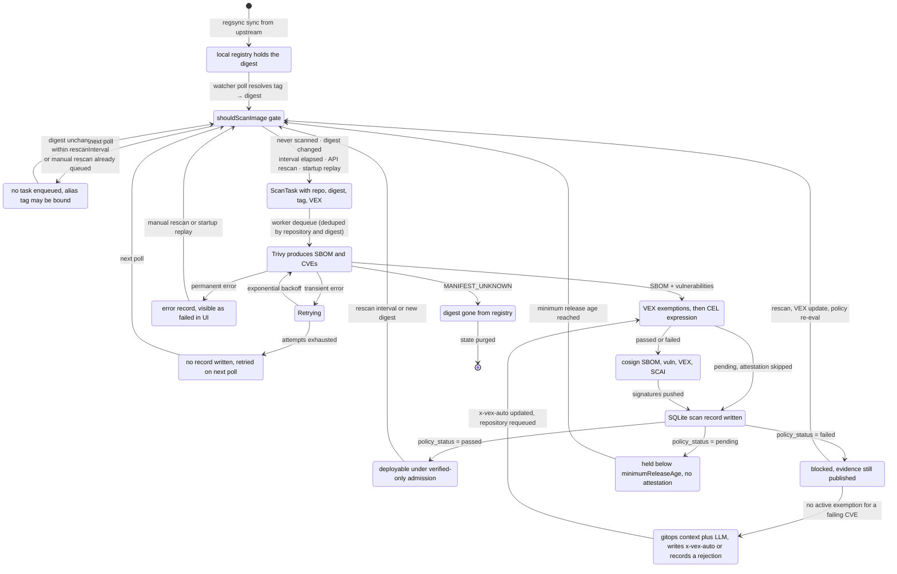
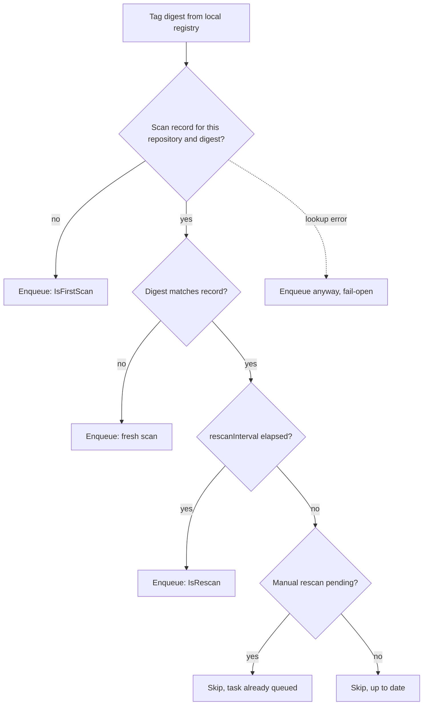
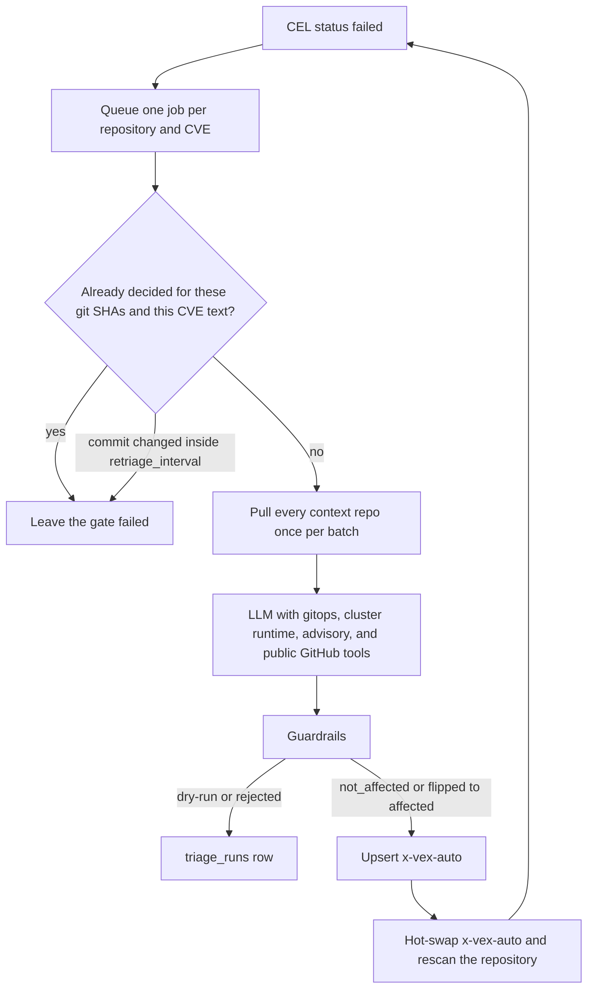

# Image Lifecycle State Machine

How a single image digest moves through suppline, from upstream registry to a policy verdict the cluster can enforce.

## Full lifecycle

## Watcher scan gate

`shouldScanImage` decides whether a polled tag becomes a queued task. It fails open: if the state lookup itself errors, the image is enqueued rather than silently skipped.

## Pipeline phases

The worker runs four phases per task. Each phase can end the task early.

| Phase | Does | Early exits |
|-------|------|-------------|
| Scan | Trivy SBOM + vulnerability scan | `MANIFEST_UNKNOWN` triggers digest cleanup; permanent errors record a failed scan |
| Evaluate | Apply active `not_affected` VEX, then the CEL expression | `pending` verdict sets `ShouldAttest=false` and skips attestation |
| Attest | cosign SBOM, vulnerability, VEX, and SCAI attestations | VEX attestation only when CVEs were exempted |
| Persist | Write scan record, vulnerabilities, tag bindings | Transient errors retry; permanent errors are logged without undoing attestations |

After persist, a `failed` decision enqueues Triage. Triage does not run on the scan worker.

## Triage

Triage is the escalation layer for a CEL failure. It answers whether that CVE affects this deployment, using gitops checkouts as the source of context.

### What gets queued

A failed scan queues one job for each policy-failure finding that does not already have an unexpired `not_affected` statement. By default only images currently running in a cluster are queued (`only_in_use`, the same runtime window as the `source="runtime"` alerts). Set `only_in_use: false` to triage every failure. Hand-written `x-vex` and generated `x-vex-auto` both count. Jobs sit on a separate queue so scans are not blocked. Each batch pulls the configured gitops repositories once. Renewal skips a repository that has no in-use image when `only_in_use` is on. **Triage now** in the UI queues the policy failures in the current view and runs them again even when a cached decision exists.

### Dedupe

A job is skipped when the latest cached run (`dry_run`, `committed`, `written`, `rejected_by_guardrail`) used the same checkout SHAs and the same CVE text (package, versions, severity, description). A changed checkout is retried at most once per `retriage_interval` (default 24h). `error` and `push_failed` are not cached, so those pairs are tried again. Renewal of a statement inside `renew_before` of `expires_at` bypasses the same-SHA cache once the interval has elapsed.

### Decision

The model may only create `not_affected` when all of the following hold:

- the justification is in `allowed_justifications` (default: `requires_configuration`, `requires_environment`, `protected_at_perimeter`, `protected_at_runtime`, `protected_by_mitigations`, `code_not_reachable`)
- confidence is at least `min_confidence` (default 0.8)
- every evidence quote matches a line suppline actually read. Deployment justifications need a gitops line. `code_not_reachable` needs a line from `public_code` or from grep or read_file on the public checkout of the image's source commit. An empty grep is not evidence
- the CVE is not in the CISA KEV feed (`block_kev`, default true). If `cisa.gov` rejects the fetch, triage uses CISA's GitHub copy of the same catalog. If both fetches fail, no new exemption is written and the run is retried
- `mode` is `enforce`. `dry-run` (the default) only records the decision

`x-vex` is never edited. The statement is upserted into `x-vex-auto` on the matching sync entry. On a matching id, `x-vex` wins and the auto statement has no effect. `detail` records that the statement was auto-generated, plus the model, triage id, timestamp, and checkout SHAs. `expires_at` is set to now plus `expiry` (default 30 days).

### Apply

With `config_repo`, suppline fetches the remote, reapplies the edit on the new HEAD, commits as the configured bot author (`chore(vex): auto-triage ...`), and pushes to the branch (remote HEAD when `branch` is empty). A non-fast-forward rejection is retried three times. Any other rejection, or a non-fast-forward that survives the retries, is stored as `push_failed`. There is no merge-request fallback.

Without `config_repo`, suppline copies the current file to `suppline.yml.bak.1` (newest) through `.bak.N` (`backup_retention`, default 10) and atomically replaces the file. Enforce mode refuses to start when that file is not writable, which is the case for a read-only ConfigMap mount.

After a successful write, only the in-memory `x-vex-auto` set for that repository is replaced, and current scans of the repository are requeued. A later rollout that loads the same file does not change the decision.

### Lifecycle

A sweep, hourly and once at startup, requeues auto statements within `renew_before` (default 7 days) of expiry. A repeated `not_affected` extends `expires_at`. A changed verdict, a guardrail miss, or a new KEV listing flips an existing `not_affected` auto statement to `affected` and clears `justification` (CycloneDX allows a justification only on `not_affected`). The row stays in `x-vex-auto`. `affected` does not exempt the CVE, so the gate fails again. The reasoning is stored in `detail`.

### Budget and audit

`triage_runs` stores the verdict, justification, confidence, evidence, model, checkout SHAs, token count, status, and commit SHA. `GET /api/v1/triage` and the Triage page read that table. Tokens count toward `daily_token_budget` (default 2,000,000) per UTC day. When the budget is spent, triage waits until the next UTC day. `suppline_triage_budget_exhausted` is 1 during that wait.

## Error handling

| Error class | Behavior | Resulting state |
|-------------|----------|-----------------|
| Transient | Retry with backoff up to `RetryAttempts` (default 3) | Recovers, or abandoned with no record |
| Permanent | No retry | `ScanFailed` record with `policy_status=failed` |
| Manifest not found | Cleanup of stored state for the digest | Removed from tracking |
| Unknown | Treated as permanent | `ScanFailed` |

## Policy terminals

| Status | Attested | Meaning | Typical cause |
|--------|----------|---------|---------------|
| `passed` | Yes | Gate open, deployable under verified-only admission | CEL expression true after VEX exemptions |
| `failed` | Yes | Gate closed, evidence still published for audit | CEL expression false, e.g. `criticalCount > 0` |
| `pending` | No | Held, re-evaluated on a later scan | `minimumReleaseAge` unmet or no age source available |

See [POLICY.md](POLICY.md) for CEL expressions and VEX semantics, and [CONFIGURATION.md](CONFIGURATION.md) for `rescanInterval` and `minimumReleaseAge`.
